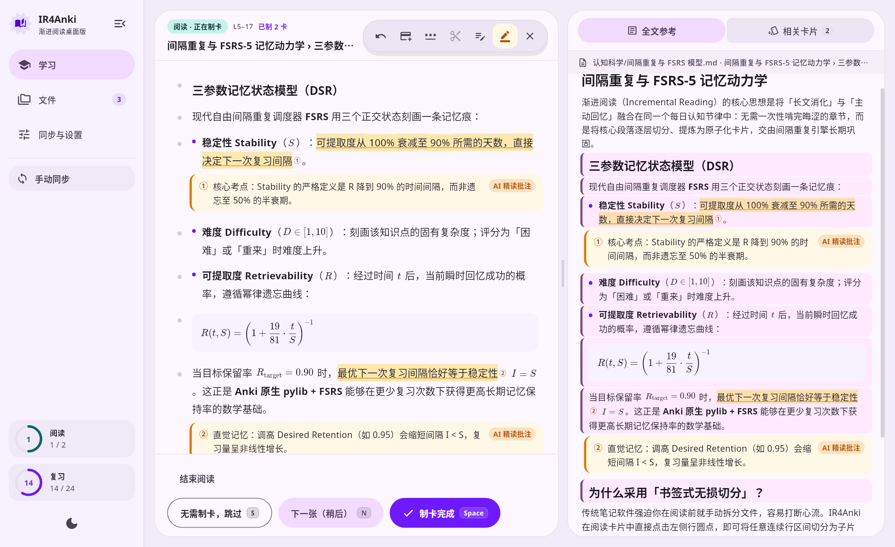
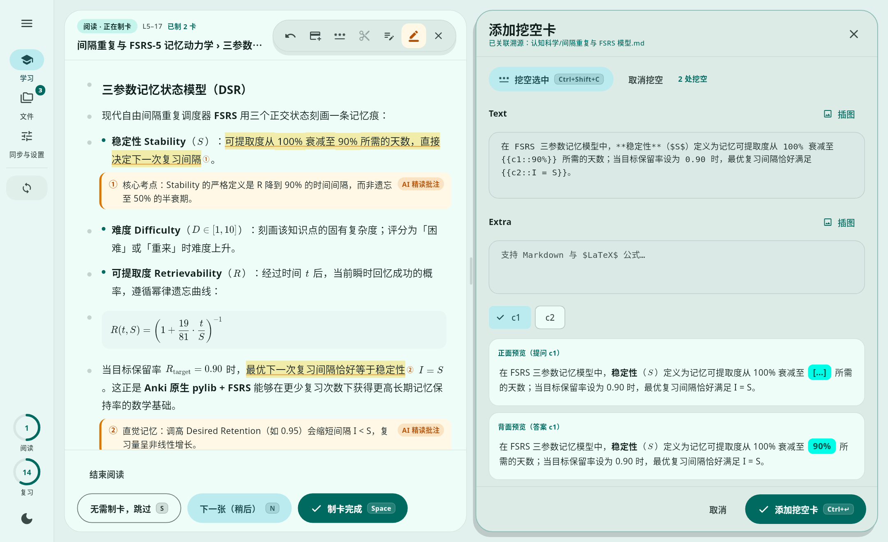
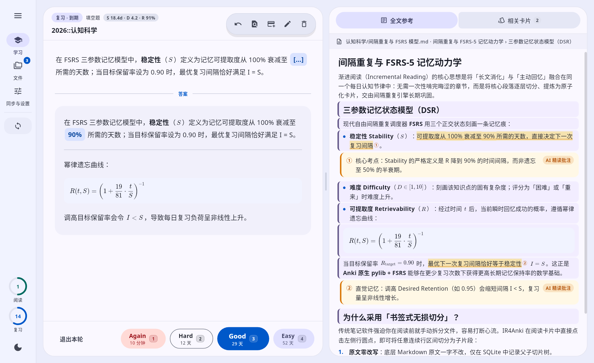
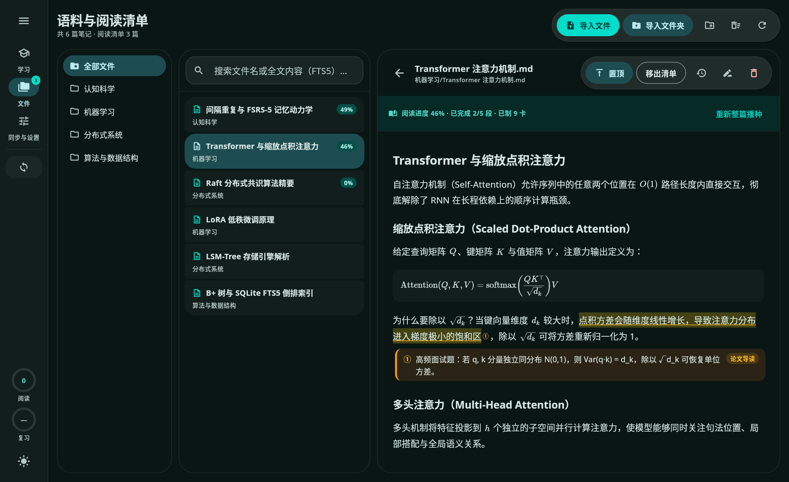
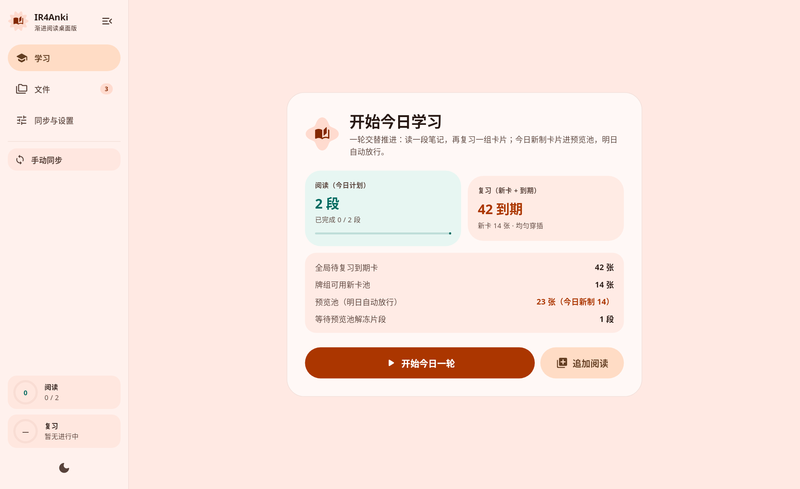
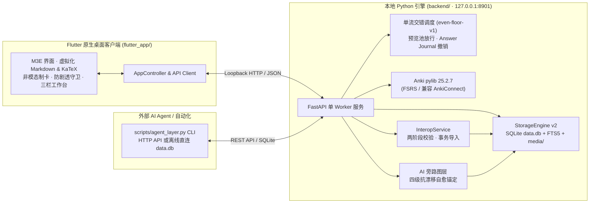

<div align="center">


# IR4Anki

**基于 Flutter（Material Design 3 Expressive）与官方 Anki `pylib` 引擎的原生桌面渐进阅读与间隔重复工作台**

*Incremental Reading meets Native Anki FSRS — Offline-first, SQLite + FTS5, Stand-off AI Highlights, Zero Browser Overhead.*

<p>
  <a href="flutter_app/"></a>
  <a href="backend/"></a>
  <a href="backend/"></a>
  <a href="scripts/agent_layer.py"></a>
  <a href="LICENSE"></a>
</p>

<p>
  <a href="#核心特性">核心特性</a> ·
  <a href="#界面预览">界面预览</a> ·
  <a href="#系统架构">系统架构</a> ·
  <a href="#快速开始">快速开始</a> ·
  <a href="#ai-agent-划重点工作流">AI 划重点</a> ·
  <a href="#键盘快捷键">快捷键</a> ·
  <a href="#配置与运维">配置与运维</a>
</p>

<br />



<sub>渐进阅读双栏工作台：左栏展示行圆点无损切分、KaTeX 公式与 AI 暖琥珀荧光高亮/考点批注条；右栏实时联动整篇上下文与关联卡片。</sub>

</div>

---

## 为什么选择 IR4Anki？

SuperMemo 开创的**渐进阅读（Incremental Reading）**将长文拆解、摘录与主动回忆融为一体，却受限于封闭生态与传统界面；而在日常使用 Markdown 笔记库 + Anki 时，阅读与制卡割裂，往往读完一整章仍未沉淀出可长期复习的记忆卡片。

**IR4Anki** 致力于把「深度阅读」与「科学记忆」重新合二为一：

- **无需离开当前语境**：在一张桌面窗口中完成长文切分、重点批注、即时制卡与 FSRS 复习。
- **彻底原生，离线优先**：采用 **Flutter 原生桌面客户端**直连本机 **Anki `pylib` 引擎**与 **SQLite 单一事实源**，无需浏览器、无需常驻桌面版 Anki，公式渲染、图片沙箱与全文检索全部 100% 本地运行。
- **数据完全归你所有**：直接复用你的官方 `collection.anki2`（完整保留原生 FSRS 调度参数）与标准 Markdown 笔记，不绑定任何专有云服务。

> [!NOTE]
> **客户端路线说明**：IR4Anki 已全面转向 **Flutter 原生桌面应用（[`flutter_app/`](flutter_app/)）** 作为唯一主线，彻底抛弃浏览器 Web 端开发。仓库中历史遗留的 [`frontend/`](frontend/) 目录已停止演进，仅作归档保留。

---

## 核心特性

### 1. Material Design 3 Expressive 原生桌面体验
- **动态表达力设计语言**：内置 4 套 Vibrant 动态配色方案（`极光紫` / `青岚绿` / `暖陶橙` / `深海蓝`）、浅色 / 深色 / 跟随系统模式，以及可切换的 Expressive / Standard 弹簧物理动效体系。
- **60fps 流畅长文渲染**：虚拟化 Markdown 渲染引擎 + 原生 KaTeX 数学公式（`flutter_math_fork`）+ `ValueNotifier` 零正文重建划词交互。
- **一等公民 Linux 桌面集成**：单实例窗口唤醒、独立桌面图标与 `.desktop` 启动器、终端一键 `ir4anki` 启动。

### 2. 单流每日交错学习（`even-floor-v1`）
- **一天只做一轮**：将待读片段与 FSRS 到期卡/新卡按比例均匀交错推进（读一段 → 复习一组卡 → 循环），兼顾输入节奏与记忆巩固。
- **预览池隔夜放行（Preview Pool）**：当日新制卡片先挂起于预览池，次日换日后按每日配额（默认 36 张）自动放行进入目标牌组，避免单日复习量雪崩。

### 3. 整文播种与「行圆点」无损书签切分
- **原文零改写**：加入阅读清单的 Markdown 文档以整篇作为根节点；阅读时点击左侧行圆点即可框选任意行区间，递归切分为待制卡子片段，底层原文一字不改。
- **渐进消化**：子片段接替当前阅读位置，未读尾部自动顺延至后续轮次，无需在阅读前手动拆文件。

### 4. 非模态悬浮制卡 + 严格防剧透守卫
- **不遮挡阅读上下文**：问答卡 / 挖空卡（Cloze）编辑抽屉以非模态方式浮于右栏，左栏正文始终可滚动、可复制；选中文本按 `C` 或在编辑器按 `Ctrl+Shift+C` 即可一键生成 `{{c1::...}}` 挖空，支持正反面 Markdown + KaTeX 实时预览与本地插图。
- **防剧透守卫（Answer-Leak Guard）**：复习卡片翻面前严格遮蔽右栏辅助参考区；翻面后自动解锁，支持一键**原文溯源**直达制卡片段，并在 4 个评分按钮上直显 FSRS 下次间隔预测及 `S / D / R` 记忆状态徽章。

### 5. AI 旁路划重点与批注图层（原文零污染）
- **Stand-off 架构**：AI 高亮与块级考点批注条独立存储在 SQLite `ai_annotations` 表中，绝不往 Markdown 正文写入脏标记，不干扰切片指纹与划词挖空；左栏工具栏支持一键显隐。
- **四级抗编辑漂移自愈引擎**：当原文发生编辑时，自动依次执行 **精确匹配 → Markdown/标点骨架映射 → 上下文夹逼 → K-mer 局部模糊对齐** 重新锚定；若对应段落被删后又回滚恢复，批注会自动自愈。
- **原生面向 AI Agent**：提供 [`scripts/agent_layer.py`](scripts/agent_layer.py) CLI 与 REST API，可接入任意 Coding/Study Agent 对语料批量划重点。

### 6. Storage v2 现代存储与三栏文件工作台
- **SQLite 单一事实源 + 媒体沙箱**：所有笔记、切片、溯源与版本历史统一收敛至 `data.db`，图片以 SHA-256 去重后存放在 `media/` 沙箱并通过 `` 引用。
- **完整的知识库管理**：
  - **FTS5 全文检索**：内置 Trigram + CJK 短词回退检索与高亮摘要预览。
  - **历史版本时间旅行**：每次编辑或覆盖前自动留存快照，支持预览与一键回滚。
  - **安全回收站**：软删除的笔记与文件夹可随时恢复，且**即使原文进入回收站，已创建的 Anki 卡片仍可完整溯源**。
  - **事务性批量导入（InteropService）**：支持文件/整文件夹连同相对路径图片原子导入，内置 `skip` / `rename` / `overwrite` 冲突解决策略。

### 7. 官方 Anki `pylib` 引擎 & 本地数据安全
- **无头原生驱动**：默认直连官方 `anki==25.2.7`（同时兼容 AnkiConnect 桌面模式），完整复用你的集合模板、媒体目录与 FSRS 参数。
- **持久化撤销与受控同步**：最近一次评分通过 Answer Journal 跨重启持久化可撤销；默认采用手动确认同步策略，仅连接你显式配置的自建同步服务器，绝不隐式回退或自动覆盖全量同步。

---

## 界面预览

<table>
  <tr>
    <td width="50%">
      
      <p align="center"><b>非模态悬浮制卡抽屉（青岚绿 · 浅色）</b><br /><sub>左栏原文始终可读可复制，右栏即时编辑 Cloze/QA 卡片并实时预览正反面与 KaTeX 公式</sub></p>
    </td>
    <td width="50%">
      
      <p align="center"><b>FSRS 复习与卡片原文溯源（深海蓝 · 浅色）</b><br /><sub>直显 S/D/R 记忆状态与 4 档预测下次间隔，翻面后右栏自动定位制卡出处与高亮上下文</sub></p>
    </td>
  </tr>
  <tr>
    <td width="50%">
      
      <p align="center"><b>三栏文件工作台（青岚绿 · 深色模式）</b><br /><sub>目录树、阅读清单进度、FTS5 全文检索、历史版本回滚、回收站与批量导入一站集成</sub></p>
    </td>
    <td width="50%">
      
      <p align="center"><b>每日单流学习驾驶舱（暖陶橙 · 浅色）</b><br /><sub>清晰呈现今日阅读计划、FSRS 待复习/新卡数量与预览池明日放行额度，一键开启本轮</sub></p>
    </td>
  </tr>
</table>

---

## 系统架构



### 仓库结构

```text
ir4anki/
├── flutter_app/         # Flutter 原生桌面客户端（Material Design 3 Expressive，当前主线）
│   ├── lib/
│   │   ├── screens/     # 学习驾驶舱、双栏工作台、三栏文件工作台、同步与设置
│   │   ├── widgets/     # M3E 组件库、虚拟化 Markdown/KaTeX、制卡抽屉、AI 高亮渲染
│   │   ├── services/    # API 客户端、Cloze 解析、行切分引擎、AI 图层匹配引擎
│   │   └── theme/       # M3E 配色、弹簧物理动效、30 级排版体系
│   └── run-desktop.sh   # Release 构建与 Linux 原生系统应用一键安装脚本
├── backend/             # FastAPI 本地引擎 + 官方 Anki pylib 25.2.7 集成
│   ├── storage/         # Storage v2（SQLite 单一事实源、FTS5、版本历史、回收站、媒体沙箱）
│   ├── interop/         # Joplin 式模块化导入框架（两阶段校验 + 事务落盘）
│   └── app.py           # 核心 API、单流交错调度与防冲突守卫
├── scripts/             # AI Agent 划重点 CLI (agent_layer.py) 及自动化测试套件
├── deploy/              # systemd 用户服务模板、配置示例、离线快照备份与检查脚本
└── docs/                # 设计文档、迁移手册与截图资源
```

---

## 快速开始

### 环境要求

| 组件 | 要求 | 说明 |
| --- | --- | --- |
| **操作系统** | Linux 桌面环境（Debian / Ubuntu / Arch / Fedora 等） | Flutter GTK3 原生桌面构建，需要 `clang`、`cmake`、`ninja-build`、`pkg-config`、`libgtk-3-dev` |
| **Python** | `>= 3.10`（含 `venv` 或 `uv`） | 后端固定依赖 `anki==25.2.7`、`fastapi`、`markdown-it-py==4.0.0` |
| **Flutter SDK** | `>= 3.24`（Dart SDK `^3.8.0`） | 用于编译独立 Release 桌面二进制 |
| **Anki 集合** | 已有 `collection.anki2` | 建议先在桌面版 Anki 中准备好牌组与问答/填空笔记类型，**启动原生引擎前完全关闭桌面 Anki** |

> [!IMPORTANT]
> `pylib` 模式直接接管 `collection.anki2`：同一集合**同一时刻只能由一个进程、单个 worker 打开**。启动 IR4Anki 后端前请确认桌面版 Anki 已彻底退出，切勿让测试实例指向你的生产集合。

### 第一步：配置并启动本地后端引擎

```bash
git clone https://github.com/Mifune-Shioriko/ir4anki.git
cd ir4anki

# 1. 创建 Python 虚拟环境并安装后端依赖（推荐使用 uv，也可用 python3 -m venv + pip）
python3 -m venv backend/.venv
backend/.venv/bin/pip install -r backend/requirements.txt

# 2. 生成本机私有配置（权限 600，切勿提交到仓库）
install -m 600 deploy/ir4anki.env.example ~/.config/ir4anki.env
```

编辑 `~/.config/ir4anki.env`，填入绝对路径（不要使用 `~`）：

```ini
IR4ANKI_HOST=127.0.0.1
IR4ANKI_PORT=8901
ANKI_BACKEND=pylib
ANKI_COLLECTION_PATH=/home/yourname/.local/share/Anki2/User 1/collection.anki2
ANKI_MEDIA_DIR=/home/yourname/.local/share/Anki2/User 1/collection.media
ANKI_STATE_DIR=/home/yourname/.local/state/ir4anki
ANKI_NOTES_DIR=/home/yourname/anki-notes
ANKI_BACKUP_DIR=/home/yourname/.local/state/ir4anki/anki-backups
ANKI_ADD_MODEL=问答题
ANKI_ADD_CLOZE_MODEL=填空题
ANKI_READING_MODE=1
ANKI_PREVIEW_MODE=1
```

验证配置并启动本地引擎（单 worker）：

```bash
# 校验配置与集合路径
backend/.venv/bin/python deploy/native.py check --env "$HOME/.config/ir4anki.env" --require-offline

# 方式 A：直接前台启动（适合快速试用）
set -a && source ~/.config/ir4anki.env && set +a
backend/.venv/bin/python -m uvicorn --app-dir backend app:app --host "$IR4ANKI_HOST" --port "$IR4ANKI_PORT" --workers 1

# 方式 B：注册为 systemd 用户常驻服务（开机自启，参考 deploy/ir4anki.service）
mkdir -p ~/.config/systemd/user
sed "s|@REPO@|$PWD|g" deploy/ir4anki.service > ~/.config/systemd/user/ir4anki.service
systemctl --user daemon-reload && systemctl --user enable --now ir4anki
```

### 第二步：构建并安装 Flutter 原生桌面客户端

```bash
# 编译 Release 桌面包并安装为系统原生应用
# 自动部署至 ~/.local/share/ir4anki-desktop/、~/.local/bin/ir4anki 与系统应用启动器
./flutter_app/run-desktop.sh --install-app --rebuild

# 直接启动（或从 KDE / GNOME 应用菜单搜索 "IR4Anki" 打开）
ir4anki
```

首次启动后，客户端默认连接 `http://127.0.0.1:8901`。你也可以在左侧导航栏 **「同步与设置」** 中修改后端地址、切换 4 套 M3E 动态配色、调整深浅色主题与弹簧动效风格。

---

## AI Agent 划重点工作流

IR4Anki 内置专为 AI Agent 设计的旁路精读图层，既支持连接运行中的本机服务，也支持离线直接读写 SQLite `data.db`：

```bash
# 1. 搜索或列出语料库中的笔记
python3 scripts/agent_layer.py notes --query "FSRS"

# 2. 读取笔记指定行范围及已有批注
python3 scripts/agent_layer.py read --note "认知科学/间隔重复与 FSRS 模型.md" --start 1 --end 120

# 3. 写入单条高亮与考点批注（原文零修改，自带四级抗编辑漂移锚定）
python3 scripts/agent_layer.py add \
  --note "认知科学/间隔重复与 FSRS 模型.md" \
  --layer "AI 精读批注" \
  --quote "可提取度从 100% 衰减至 90% 所需的天数，直接决定下一次复习间隔" \
  --comment "核心考点：Stability 是 R 降到 90% 的时间间隔，而非半衰期。"

# 4. 批量导入 JSON 批注或清空指定图层
python3 scripts/agent_layer.py batch --note "认知科学/间隔重复与 FSRS 模型.md" --layer "AI 精读批注" --file highlights.json
python3 scripts/agent_layer.py clear --note "认知科学/间隔重复与 FSRS 模型.md" --layer "AI 精读批注"
```

在桌面端阅读或预览该笔记时，点击工具栏荧光笔图标即可一键切换 AI 重点图层显示。

---

## 键盘快捷键

桌面端全流程支持键盘优先操作，减少鼠标往返：

| 场景 | 快捷键 | 动作 |
| --- | --- | --- |
| **渐进阅读** | `Space` | 标记当前片段「制卡完成」并推进流程 |
| **渐进阅读** | `A` | 在右侧呼出非模态「添加问答卡」抽屉 |
| **渐进阅读** | `C` | 将选中文本自动包裹为 `{{c1::...}}` 并呼出挖空卡抽屉 |
| **渐进阅读** | `S` / `N` | 无需制卡跳过 / 移至本轮稍后（下一张） |
| **渐进阅读** | `Esc` | 取消当前行圆点切分选区（溯源模式中再次按下返回复习） |
| **FSRS 复习** | `Space` | 翻转显示卡片答案（同时解除右栏防剧透锁定） |
| **FSRS 复习** | `1` / `2` / `3` / `4` | 评分：重来（Again）/ 困难（Hard）/ 良好（Good）/ 容易（Easy） |
| **复习 / 阅读** | `Ctrl + Z` | 持久化撤销最近一次 Anki 卡片评分 |
| **制卡抽屉** | `Ctrl + Shift + C` | 将编辑器内选中文本一键包裹为新挖空 |
| **制卡抽屉** | `Ctrl + Enter` | 保存并提交当前卡片至预览池 / 目标牌组 |

---

## 配置与运维

<details>
<summary><b>每日学习与预览池默认参数</b></summary>

| 环境变量 | 默认值 | 说明 |
| --- | --- | --- |
| `ANKI_RELEASE_DAILY_GOAL` | `36` | 预览池每日最多自动放行的新卡预算（更早制卡优先）；不限制总复习量 |
| `ANKI_DAILY_NEW` | `0` | 每轮领取的可领取新卡上限；`0` 表示不额外限制 |
| `ANKI_REVIEW_DUE_DIVISOR` | `1` | 本日首次领取时记录到期量，默认覆盖整批到期卡 |
| `ANKI_ROLLOVER_HOUR` | `4` | 本地时间凌晨 4 点换日，应与 Anki 集合设置保持一致 |
| `ANKI_REVIEW_DECK` | *(空)* | 空值覆盖全部牌组；指定牌组名时自动包含其子牌组 |
| `ANKI_PREVIEW_DECK` | `预览池` | 新制卡片隔夜暂存牌组（启用 `ANKI_PREVIEW_MODE=1` 时生效） |
| `ANKI_PREVIEW_RELEASE_DECK` | `2026` | 次日自动放行的目标牌组名称 |

</details>

<details>
<summary><b>同步策略、AnkiConnect 兼容与网络安全边界</b></summary>

- **手动同步优先**：默认 `ANKI_SYNC_POLICY=manual`，启动、评分与制卡不会自动联网。确认手动同步前会先提交当前持久化撤销点；若遇到需要全量同步的情况，引擎会拒绝擅自决定上传/下载方向，提示先备份再使用同版本桌面 Anki 人工处理。
- **自建同步服务器**：需显式设置 `ANKI_SYNC_ENDPOINT` 以及 `ANKI_SYNC_HKEY`（或 `ANKI_SYNC_USERNAME` / `ANKI_SYNC_PASSWORD`），仅连接你自己的账户，不隐式回退至 AnkiWeb。
- **AnkiConnect 兼容路径**：若希望继续配合桌面版 Anki 使用，可在 `~/.config/ir4anki.env` 中设置 `ANKI_BACKEND=connect` 与 `ANKICONNECT_URL=http://127.0.0.1:8765`。
- **单用户安全边界**：默认监听 `127.0.0.1`。如通过局域网或 Tailscale 访问后端，需设置 `IR4ANKI_HOST=0.0.0.0`、`ANKI_TRUSTED_HOSTS=<主机名或IP>`，并配置 `ANKI_ENGINE_API_TOKEN` 用于远程管理与同步接口。**请勿将本服务直接暴露于公网多人使用。**

</details>

<details>
<summary><b>完整离线备份与恢复（推荐升级前执行）</b></summary>

集合（`collection.anki2` + `collection.media`）存储卡片与卡片媒体，而 `ANKI_STATE_DIR`（`data.db` + `media/`）存储全部 Markdown 语料、渐进阅读进度、溯源关系与 AI 批注。**Anki 同步不会同步阅读状态与语料库**，跨设备迁移或重大升级前请使用内置离线快照工具：

```bash
# 1. 确认已关闭桌面 Anki 并停止本地服务
systemctl --user stop ir4anki

# 2. 创建完整离线快照（输出目录必须位于源数据目录之外，且妥善私密保管）
backend/.venv/bin/python deploy/native.py backup \
  --env "$HOME/.config/ir4anki.env" \
  --output /absolute/path/to/ir4anki-backups \
  --offline-confirmed
```

备份脚本会自动校验无活跃服务、无桌面 Anki 进程、无未提交答案撤销日志，随后打包集合、媒体、状态库、语料与本机配置。

</details>

---

## 开发与测试

```bash
# Flutter 桌面客户端静态分析与单元测试
cd flutter_app
flutter analyze --no-fatal-infos
flutter test
flutter build linux --release

# Python 后端存储、AI 图层与导入器测试
cd ..
backend/.venv/bin/python -m unittest discover -s scripts -p "*_test.py"
```

### 延伸文档

- [交错学习流设计](docs/interleaved-flow.md) · [书签式无损切分](docs/bookmark-reading.md) · [非模态制卡抽屉](docs/card-drawer.md)
- [复习牌组范围说明](docs/review-deck-scope.md) · [文件夹与 Interop 导入架构](docs/file-import-joplin-redesign.md)
- [离线使用指南](docs/offline-use.md) · [原生 `pylib` 迁移与应急处理](docs/pylib-migration.md) · [原生能力验证](docs/pylib-verification.md)

---

## 开源协议

本项目采用 **[GNU AGPL v3 或更新版本](LICENSE)** 许可协议（包含集成官方 Anki `pylib` 的相应许可义务）。如对外向网络用户提供修改后的服务，请依照 AGPL 第 13 条提供对应源码。历史 MIT 授权仍然有效，版权归属及第三方声明详见 [NOTICE](NOTICE)。
