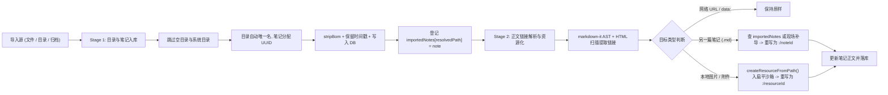
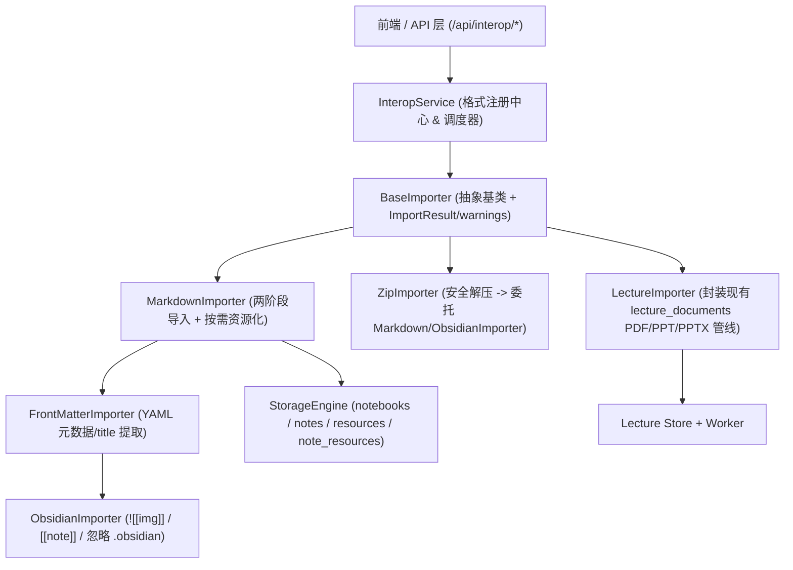
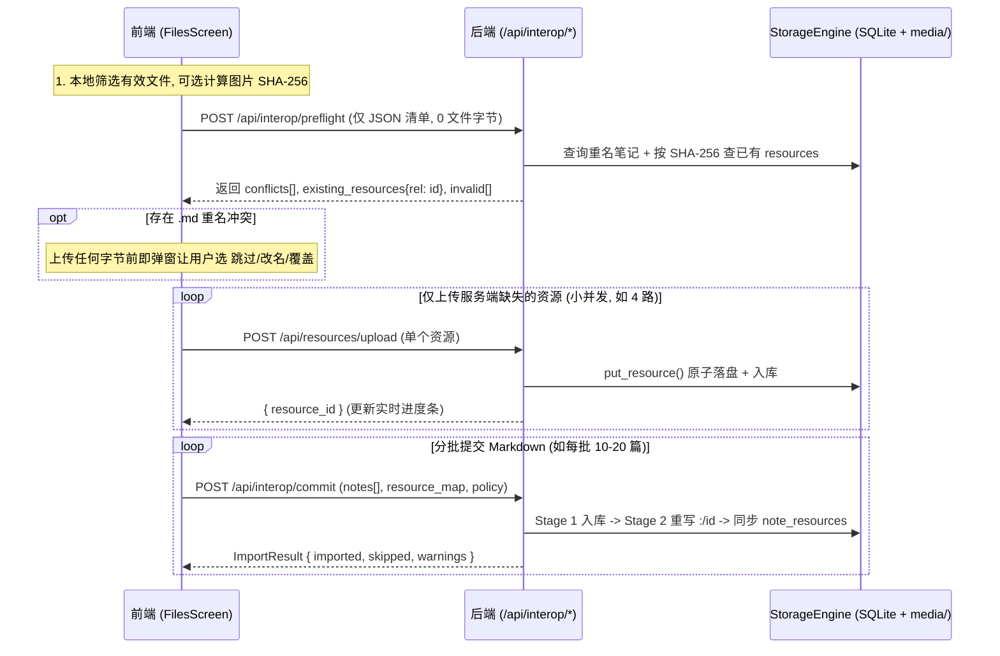

# Joplin vs. `ir4anki` 文件导入机制对比与重构方案报告

> [!IMPORTANT]
> **核心结论**：`ir4anki` 已在数据层建成了 Joplin 风格的 `StorageEngine`（SQLite `notebooks` / `notes` / `resources` / `note_resources` + 扁平 `media/<id>.<ext>` 沙箱 + `:/<id>` 引用），但文件导入链路 [`files_upload`](file:///home/shioriko/ir4anki/backend/app.py#L4678-L4910) 依然绑死在旧的**物理磁盘语料库（`NOTES_DIR`）模型**与**单请求全量上传**之上。这导致系统处于“双主存储割裂”状态，不仅体验沉重、上限卡死，还埋下了 **`note_resources` 断链 → GC 误删图片** 的严重数据隐患。
>
> **P0 核心目标**：彻底改造为 **Joplin 式导入架构**——以 `StorageEngine` 为唯一可信来源（SSOT），全面采用「统一 `InteropService` 调度 + 两阶段导入 + 按需资源 UUID 化（`:/<resource_id>`）+ 非阻断容错」，彻底砍掉物理路径查重、图片前缀改名和 `_assets` 特例逻辑。

---

## 一、Joplin 文件导入架构剖析

本地 Joplin 仓库已更新至 `dev` 最新提交 `268fd6f1e`。Joplin 的导入体系集中在 `packages/lib/services/interop/`，其工程稳定性与良好体验来自以下四个核心设计：

### 1. 统一的模块注册与继承复用体系
- **中心化注册表**：[`InteropService.ts`](file:///home/shioriko/Projects/joplin/packages/lib/services/interop/InteropService.ts#L62-L220) 通过 [`makeImportModule`](file:///home/shioriko/Projects/joplin/packages/lib/services/interop/Module.ts#L66-L95) 声明所有内置格式（`jex` / `raw` / `enex` / `md` / `md_frontmatter` / `obsidian` / `html` / `txt` / `one`），每个模块仅需声明元数据（`sources` 支持文件/目录、`fileExtensions`、`isNoteArchive`、`supportsMobile`）和工厂函数。第三方插件也可通过 [`InteropService_Importer_Custom.ts`](file:///home/shioriko/Projects/joplin/packages/lib/services/interop/InteropService_Importer_Custom.ts) 动态注册，UI 监听 `modulesChanged` 事件自动更新入口。
- **按能力逐层继承**：
  - [`InteropService_Importer_Base.ts`](file:///home/shioriko/Projects/joplin/packages/lib/services/interop/InteropService_Importer_Base.ts)：定义统一生命周期 `init()` / `exec()` 和临时目录管理。
  - [`InteropService_Importer_Md.ts`](file:///home/shioriko/Projects/joplin/packages/lib/services/interop/InteropService_Importer_Md.ts)：实现递归目录导入、跳过空目录、去 BOM、创建笔记、两阶段本地文件转资源。
  - [`InteropService_Importer_Md_frontmatter.ts`](file:///home/shioriko/Projects/joplin/packages/lib/services/interop/InteropService_Importer_Md_frontmatter.ts)：继承 `Md`，叠加 YAML Front Matter 元数据/标签与 `_folder.yml` 文件夹元数据解析。
  - [`InteropService_Importer_Obsidian.ts`](file:///home/shioriko/Projects/joplin/packages/lib/services/interop/InteropService_Importer_Obsidian.ts)：继承 `Md_frontmatter`，叠加忽略 `.obsidian`/`.trash`、`![[img|WxH]]` 附件解析、`[[note#heading|alias]]` 双向链接转换、`#tag` 提取与全库唯一名反查。
- **复杂/归档格式降维委托**：
  - [`InteropService_Importer_Jex.ts`](file:///home/shioriko/Projects/joplin/packages/lib/services/interop/InteropService_Importer_Jex.ts) 将 `.jex`（tar 归档）解压至临时目录，直接委托给 [`InteropService_Importer_Raw.ts`](file:///home/shioriko/Projects/joplin/packages/lib/services/interop/InteropService_Importer_Raw.ts) 执行统一的 `itemIdMap` UUID 重映射。
  - [`InteropService_Importer_OneNote.ts`](file:///home/shioriko/Projects/joplin/packages/lib/services/interop/InteropService_Importer_OneNote.ts) 将 `.zip`/`.one`/`.onepkg` 转换为临时 HTML 目录后，直接复用 `InteropService_Importer_Md` 子类，并通过 `setLinkedFilesBaseDir()` 配合 [`resolvePathWithinDir.ts`](file:///home/shioriko/Projects/joplin/packages/lib/utils/resolvePathWithinDir.ts) 防范路径穿越。

### 2. 核心工作流：两阶段导入 + 按需资源 UUID 化

这一设计的精妙之处在于：
1. **彻底消除物理路径命名冲突**：文件夹通过 `Folder.findUniqueItemTitle()` 自动加序号，笔记与资源全部以 UUID 为主键，不再存在“同名图片互相覆盖”或“必须保留 `_assets` 子目录结构”的包袱。
2. **资源按需入库（不吸垃圾文件）**：第一阶段只扫笔记，第二阶段只把**正文真正引用到的本地文件**通过 [`shim.createResourceFromPath`](file:///home/shioriko/Projects/joplin/packages/lib/shim-init-node.ts#L305-L380) 写入扁平资源库（按扩展名 + magic bytes 判定 MIME），目录下未被引用的临时文件或杂图不会被无脑塞入数据库。
3. **跨笔记互链天然成立**：因为第一阶段已经把所有笔记建好并记录了 `path -> note.id` 映射，第二阶段可以无顺序依赖地完成笔记间相互引用改写。

### 3. 流式分批与非阻断容错
- **大文件流式分批**：[`import-enex.ts`](file:///home/shioriko/Projects/joplin/packages/lib/import-enex.ts#L639-L796) 使用 `saxStream` 流式解析 XML，每累计 `batchSize = 10` 篇即落盘释放内存，Base64 附件也流式解码落盘，内存占用与导入体量解耦。
- **统一告警而非一票否决**：[`types.ts`](file:///home/shioriko/Projects/joplin/packages/lib/services/interop/types.ts#L43-L96) 约定 `onProgress`、`onError` 回调与 `ImportExportResult { warnings: string[] }` 返回结构。单个格式损坏条目、缺失附件、无法解码的链接均记录到 `warnings` 并继续推进其余条目，见 [`importFrom.ts`](file:///home/shioriko/Projects/joplin/packages/app-desktop/gui/WindowCommandsAndDialogs/commands/importFrom.ts#L143-L197)。

---

## 二、`ir4anki` 当前文件导入的八大不足

对照检查 `~/ir4anki` 的前后端实现（[`app.py`](file:///home/shioriko/ir4anki/backend/app.py)、[`engine.py`](file:///home/shioriko/ir4anki/backend/storage/engine.py)、[`schema.py`](file:///home/shioriko/ir4anki/backend/storage/schema.py)、[`domain.py`](file:///home/shioriko/ir4anki/backend/storage/domain.py)、[`lecture_documents.py`](file:///home/shioriko/ir4anki/backend/lecture_documents.py)、[`FilesScreen.tsx`](file:///home/shioriko/ir4anki/frontend/src/components/FilesScreen.tsx)、[`file-import.ts`](file:///home/shioriko/ir4anki/frontend/src/lib/file-import.ts)、[`api.ts`](file:///home/shioriko/ir4anki/frontend/src/api.ts)），当前导入系统存在 **8 个结构性短板**：

### 不足 1（最严重）：双主存储割裂，导致 `note_resources` 断链与 GC 误删隐患
- **代码定位**：[`files_upload`](file:///home/shioriko/ir4anki/backend/app.py#L4845-L4906)、[`_sync_note_resource_links`](file:///home/shioriko/ir4anki/backend/storage/engine.py#L577-L591)、[`extract_resource_ids`](file:///home/shioriko/ir4anki/backend/storage/domain.py#L510-L517)、[`gc_unreferenced_resources`](file:///home/shioriko/ir4anki/backend/storage/engine.py#L1105-L1115)。
- **现状与问题**：
  1. `files_upload` 把图片先原子写盘到 `NOTES_DIR`，随后在 [app.py:4878-4883](file:///home/shioriko/ir4anki/backend/app.py#L4878-L4883) 调用 `eng.import_resource_bytes(dest.name, it['data'], legacy_name=dest.name)`，却**直接丢弃了返回的 `res['id']`**。
  2. 写入 `StorageEngine` 的笔记正文 `norm_body` 仍保留 `_rewrite_image_refs` 改写后的**相对路径**（如 `_assets/book-fig1.png`），而不是 `:/<resource_id>`。
  3. `eng.create_note()` 内部调用 `_sync_note_resource_links()` 提取 `:/([a-fA-F0-9]{16,64})` 时匹配不到任何资源，导致 **`note_resources` 关联表完全为空**。
  4. **直接后果**：一旦执行 [`gc_unreferenced_resources()`](file:///home/shioriko/ir4anki/backend/storage/engine.py#L1105-L1115)，所有通过 `files_upload` 导入的图片都会被判定为“孤儿资源”并从 `media/` 沙箱和 `resources` 表中永久删除；同时整个系统被迫维护 `NOTES_DIR` 与 `StorageEngine` 两套真相（[`_corpus_files`](file:///home/shioriko/ir4anki/backend/app.py#L2134-L2160)、[`files_list`](file:///home/shioriko/ir4anki/backend/app.py#L3918-L3959)、[`files_raw`](file:///home/shioriko/ir4anki/backend/app.py#L3962-L3996) 都在读盘与读库之间反复兜底同步）。

### 不足 2：单请求“一锅端”打包上传，硬卡 100 文件 / 100 MiB 且无真实进度
- **代码定位**：[`FilesScreen.tsx`](file:///home/shioriko/ir4anki/frontend/src/components/FilesScreen.tsx#L278-L295)、[`api.ts`](file:///home/shioriko/ir4anki/frontend/src/api.ts#L192-L204)、[`app.py`](file:///home/shioriko/ir4anki/backend/app.py#L4707-L4750) 及 [`UPLOAD_MAX_FILES` / `UPLOAD_BATCH_MAX_BYTES`](file:///home/shioriko/ir4anki/backend/app.py#L6249-L6251)。
- **现状与问题**：
  1. 前端把所有 `.md` 和图片硬捆成一个 `coupled` 单元塞进**单个 `FormData`** 发给 `/api/files/upload`。
  2. 后端在落盘前把整批文件字节全部 `await _read_upload_bounded(...)` 读入内存列表 `items`。
  3. 稍大一点的书籍目录或 Obsidian 库（超过 100 个文件或 100 MiB）直接被 `413` 拒绝；导入期间没有任何逐文件进度反馈，只有整批“处理中”；一旦中途网络抖动或部分失败（`503 UploadPartialError`），前端直接停止并弹出技术化的“结果待确认，请刷新核对；不会自动重试”。

### 不足 3：先全量上传、后检测冲突，导致大文件目录白传两遍
- **代码定位**：[`FilesScreen.tsx`](file:///home/shioriko/ir4anki/frontend/src/components/FilesScreen.tsx#L276-L302) 与 [`app.py`](file:///home/shioriko/ir4anki/backend/app.py#L4779-L4823)。
- **现状与问题**：
  - 默认 `on_conflict="error"`。哪怕仅仅有一篇 `.md` 重名，前端也必须先把几十 MB 的图片与 Markdown 完整上传到后端；后端读完所有字节、加锁扫描全库后才返回 `409`；用户在弹窗选择“跳过 / 改名 / 覆盖”后，前端再把**整批几十 MB 原样重传一遍**。在局域网或移动端场景下极其耗时。

### 不足 4：全局状态锁内全盘 `rglob` + 同步 `fsync`，导入阻塞全站读写
- **代码定位**：[`app.py`](file:///home/shioriko/ir4anki/backend/app.py#L4751-L4875)。
- **现状与问题**：
  - 为了规避旧媒体路由“按 basename 全局查找”导致的重名碰撞，后端不得不在 `async with _state_lock` 全局大锁内执行 `for p in NOTES_DIR.rglob("*")` 全盘扫描收集所有图片 basename；随后在同一个锁内对每个文件做临时文件写入、`os.fsync(stream)`、原子替换和目录 `os.fsync(fd)`。
  - 这意味着大目录导入期间，整个后端事件循环与状态锁被长时间占满，其他复习、翻页、保存操作全部卡死。

### 不足 5：预检“一票否决”，缺乏单文件容错与 BOM 清洗
- **代码定位**：[`app.py`](file:///home/shioriko/ir4anki/backend/app.py#L4713-L4749)。
- **现状与问题**：
  1. 目录下只要混入**一个 0 字节的空 `.md` 文件**（很多笔记软件的模板或草稿都很常见）或**一个 GBK/非 UTF-8 编码文件**，后端直接抛 `400` 拒绝整批上传，用户只能自己去本地目录里逐个排查删除。
  2. 未做 UTF-8 BOM（`\ufeff`）剥离，带 BOM 的文件首行标题解析（`# 标题`）与分段匹配可能出现异常。
  3. 跳过清单仅在前端 [`file-import.ts`](file:///home/shioriko/ir4anki/frontend/src/lib/file-import.ts) 做扩展名和目录过滤，后端没有任何 `warnings` 机制。

### 不足 6：Markdown/图片 与 PDF/PPT/PPTX 导入管线彻底割裂
- **代码定位**：[`FilesScreen.tsx`](file:///home/shioriko/ir4anki/frontend/src/components/FilesScreen.tsx#L281-L295)、[`LectureImport.tsx`](file:///home/shioriko/ir4anki/frontend/src/components/LectureImport.tsx)、[`lecture_routes.py`](file:///home/shioriko/ir4anki/backend/lecture_routes.py#L68)、[`lecture_documents.py`](file:///home/shioriko/ir4anki/backend/lecture_documents.py#L183-L247)。
- **现状与问题**：
  - Markdown/图片走 `/api/files/upload`（`NOTES_DIR` + `StorageEngine`），PDF/PPT/PPTX 走 `/api/lectures/import`（`STATE_DIR/lectures` 独立 SQLite + Worker 转换队列），前端在 `FilesScreen` 里硬拼两套逻辑，同时还有一套独立的 `LectureImport.tsx`。
  - 两者在冲突策略、目录创建、报错格式、去重机制（课件按内容 hash 自动幂等，MD 却报 409）和结果展示上完全不统一。

### 不足 7：Markdown / Obsidian / 归档格式兼容不足，且无差别导入未引用杂图
- **代码定位**：[`_rewrite_image_refs`](file:///home/shioriko/ir4anki/backend/app.py#L4561-L4676)、[`file-import.ts`](file:///home/shioriko/ir4anki/frontend/src/lib/file-import.ts#L16-L18)。
- **现状与问题**：
  1. 为了维护相对路径改名后不爆字节预算，`_rewrite_image_refs` 手写了 115 行复杂状态机，却只处理标准 Markdown 图片 ``、引用式图片和 HTML `src`/`href`。
  2. **不支持 Obsidian 常见语法**：`![[image.png]]`、`![[image.png|400]]`、`[[其他笔记#小节|别名]]`、`#标签` 全部无法识别。
  3. **不支持笔记间互链重写**：`[下一章](./02.md)` 不会转换为内部笔记链接。
  4. **不支持 YAML Front Matter**（提取 `title` 等元数据）、不支持 `.html`/`.txt` 文档导入、不支持 `.zip` 压缩包导入。
  5. 目录里所有未被任何 `.md` 引用的图片也会被一并上传，白白占满 `UPLOAD_MAX_FILES` 与存储空间。

### 不足 8：前端交互入口受限，对大目录与移动端不友好
- **代码定位**：[`FilesScreen.tsx`](file:///home/shioriko/ir4anki/frontend/src/components/FilesScreen.tsx#L258-L267) 与 [L420-L422](file:///home/shioriko/ir4anki/frontend/src/components/FilesScreen.tsx#L420-L422)。
- **现状与问题**：
  - 显式拦截外部文件拖入（`e.dataTransfer.dropEffect = 'none'`），提示用户去点导入按钮。
  - 仅依赖 `<input webkitdirectory>` 导入目录，在移动端浏览器兼容性差，且缺少 `.zip` 归档上传作为替代通道。

### 对比总览表

| 对比维度 | Joplin | `ir4anki` 现状 |
| :--- | :--- | :--- |
| **真相源（SSOT）** | SQLite + 扁平 `resources/<id>.<ext>` | `NOTES_DIR` 磁盘与 `StorageEngine` 双写割裂 |
| **图片引用格式** | 统一 `:/<resource_id>`，天然无重名冲突 | 相对路径 + 全库 basename 查重 + 自动加前缀改名 |
| **资源引用追踪** | `Note.linkedResourceIds` 精准维护 | `files_upload` 写入后 `note_resources` 漏记（GC 风险） |
| **传输与体量上限** | 逐项/流式分批，无硬性 100 文件限制 | 单 `FormData` 打包，硬卡 100 文件 / 100 MiB |
| **重名冲突体验** | 文件夹自动唯一名 / 笔记按 UUID，不阻断 | 先传完全部字节 → 409 → 弹窗 → 再重传全部字节 |
| **单文件容错** | `warnings` 收集异常，不阻断整批 | 空文件 / 编码错 / 单文件超限一票否决整批 |
| **格式扩展架构** | `InteropService` 模块注册 + 继承复用 | 硬编码双轨（`/api/files/upload` vs `/api/lectures/import`） |
| **Obsidian / ZIP** | 原生 `Obsidian`、`Jex`、`OneNote(zip)` | 不支持 `![[...]]` / `[[...]]` / Frontmatter / `.zip` |

---

## 三、改进方向与分阶段重构路线（P0 彻底 Joplin 化）

结合你的要求，**P0 直接彻底改造为 Joplin 式导入架构**，不再在旧的 `NOTES_DIR` 物理路径方案上打补丁；随后用 P1–P3 补齐 Web 场景下的流式分步传输、格式生态与前端交互。

### P0：彻底改造为 Joplin 式导入架构（核心必做）

#### 1. 核心架构原则
- **唯一可信来源（SSOT）**：导入直接写入 `StorageEngine`（`data.db` + `media/` 扁平沙箱）。**彻底切断导入链路对 `NOTES_DIR` 的写入依赖**；如果仍需本地目录可读，将 `NOTES_DIR` 降级为显式/按需的导出目标（类似 Joplin 的 `Exporter_Md`），不再由磁盘反过来约束导入规则。
- **彻底告别物理路径碰撞与改名**：
  - 目录 → 映射到 `notebooks` 表（树形 `parent_id` + UUID），复用 `resolve_or_create_notebook_path` 或按需生成唯一名。
  - 笔记 → 映射到 `notes` 表（UUID 主键，保留 `title`、`notebook_id`、`body`）。
  - 图片/附件 → 全部通过 [`eng.put_resource()`](file:///home/shioriko/ir4anki/backend/storage/engine.py#L1003-L1060) 进入扁平 `media/<id>.<ext>` 沙箱，自带 **SHA-256 内容去重**。
  - 正文引用 → 统一改写为 Joplin 原生格式 ``（前端 [`markdown.ts`](file:///home/shioriko/ir4anki/frontend/src/lib/markdown.ts#L91-L96) 已原生支持渲染 `:/<id>`！）。

#### 2. 后端 `backend/interop/` 模块设计（1:1 对标 Joplin `services/interop/`）

建议在 `backend/interop/` 下建立清晰的分层模块：
- `backend/interop/types.py`：定义 `ImportOptions`、`ImportResult(imported_notes, imported_resources, reused_resources, skipped, warnings)`、`ImportModuleMeta`。
- `backend/interop/service.py`：`InteropService` 注册中心，按格式/扩展名路由到对应 `Importer`，统一聚合 `warnings` 与进度回调。
- `backend/interop/base.py`：`BaseImporter`，封装临时目录生命周期、路径安全校验（对标 Joplin [`resolvePathWithinDir.ts`](file:///home/shioriko/Projects/joplin/packages/lib/utils/resolvePathWithinDir.ts)）和错误转 `warning` 辅助方法。
- `backend/interop/md_importer.py`：**核心两阶段导入器**（对标 [`InteropService_Importer_Md.ts`](file:///home/shioriko/Projects/joplin/packages/lib/services/interop/InteropService_Importer_Md.ts)）：
  - **Stage 1（笔记与笔记本入库）**：
    - 忽略系统目录（`.git` / `.obsidian` / `.trash` / `node_modules` / `__pycache__`）与不含有效笔记的空目录。
    - 逐篇读取 `.md`：安全解码（UTF-8，自动 `lstrip('\ufeff')` 去 BOM；编码错误记入 `warnings` 跳过，不炸整批）；空文件允许跳过并记入 `skipped` 而非 400 报错。
    - 按冲突策略（`skip` / `rename` / `overwrite`）创建或更新 `notes`，登记 `imported_notes[norm_rel_path] = note_id`。
  - **Stage 2（正文链接解析与按需资源化）**：
    - 使用 `markdown-it` AST + 线性 HTML 标签扫描（避开 fenced code block 与 inline code）提取所有本地链接。
    - 跳过 `http://`、`https://`、`data:`、`:/` 和纯 `#anchor`。
    - 对指向本批次本地图片的链接：通过 `eng.put_resource(filename, data, deduplicate=True)` 入库（自动 SHA-256 去重），拿到 `resource_id`，将正文中的原链接（含 URL 编码/未编码形式，保留 `#fragment` / `?query`）替换为 `:/<resource_id>`。
    - 对指向本批次其他 `.md` 的链接：查 `imported_notes[target_rel]`，替换为 `:/<note_id>`（或保留 `#heading`）。
    - 调用 `eng.update_note_body()` / `eng._sync_note_resource_links()`：**自动建立完整的 `note_resources` 关联表**，彻底消除 GC 误删风险。
    - **关键优化**：仅导入被笔记正文引用到的图片（以及用户显式单独选择的纯图片文件），目录里的无用杂图不再污染资源库。

#### 3. P0 改造后可直接废弃的旧负担代码
一旦导入彻底切入 Joplin 模式，以下沉重且脆弱的历史逻辑可以直接移除：
- `files_upload` 中 `async with _state_lock` 里的全盘 `NOTES_DIR.rglob("*")` 图片名扫描；
- 图片 basename 碰撞时“拼目录前缀 + `(N)` 改名”的整套逻辑（[app.py:4798-4816](file:///home/shioriko/ir4anki/backend/app.py#L4798-L4816)）；
- `_files_resolve(..., upload_image=True)` 中针对 `_assets` 的脆弱白名单例外（[app.py:4143-4145](file:///home/shioriko/ir4anki/backend/app.py#L4143-L4145)）；
- 115 行手写 `_rewrite_image_refs` 及其“改写后相对路径字节膨胀预算检查”（改写为固定 34 字符 `:/<32-hex>` 后长度有界且可控）；
- `files_upload` 末尾对 `NOTES_DIR` 的逐文件 `os.fsync` 双写逻辑。

> [!TIP]
> **平滑兼容策略**：在完全移除 `NOTES_DIR` 镜像前，如果仍有外部脚本依赖 `NOTES_DIR`，可保留一个显式的「导出到目录（Markdown Exporter）」命令或配置项开关，而**绝不让 `NOTES_DIR` 参与导入时的冲突检测、图片命名或 `_corpus_files()` 反向污染**。同时给 [`extract_resource_ids`](file:///home/shioriko/ir4anki/backend/storage/domain.py#L510-L517) 补充测试，确保 ``、`">`、`` 都能被准确索引到 `note_resources`。

---

### P1：Web 端三步流式导入协议（解决 100 文件上限、重复传输与进度可视化）

Joplin 运行在 Electron/本地文件系统可以直接读盘，而 `ir4anki` 是 Web 前后端分离架构。在 P0 的 Joplin 存储模型基础上，将单次大 `FormData` 升级为 **3 步轻量协议**：

带来的直接收益：
1. **彻底消除 409 二次重传**：冲突在 Preflight 阶段（纯 JSON，毫秒级）就暴露并决策完毕。
2. **图片天然“秒传”**：基于 `StorageEngine` 已有的 `resources.sha256` 索引，前端用 `crypto.subtle.digest('SHA-256', buf)` 预算哈希，已存在的图片连字节都不用传，直接复用 `resource_id`。
3. **彻底突破 100 文件 / 100 MiB 限制**：资源单文件流式上传、笔记分小批提交，内存恒定，且每个请求都是短事务，不再长占 `_state_lock`。
4. **真正的进度条与局部重试**：前端可精确展示“上传图片 18/42 · 导入笔记 12/30”，单张图片网络失败只需重试那一张。

---

### P2：格式扩展与全管线统一（Obsidian + ZIP 归档 + 课件收口）

1. **`ObsidianImporter`（继承 `FrontMatterImporter` → `MarkdownImporter`）**：
   - 参考 [`InteropService_Importer_Obsidian.ts`](file:///home/shioriko/Projects/joplin/packages/lib/services/interop/InteropService_Importer_Obsidian.ts)，在代码块外解析：
     - 附件嵌入：`![[foo.png]]` → ``；带尺寸 `![[foo.png|400]]` / `![[foo.png|400x300]]` → `" width="400" .../>`。
     - 笔记互链：`[[Target#Heading|Alias]]` → `[Alias](:/<note_id>#slug)`（支持 Vault 内唯一 basename 大小写不敏感匹配）。
     - 自动剥离/读取 YAML Front Matter 的 `title`（及未来可扩展的 `tags`）。
2. **`ZipImporter`（强力推荐，直击大目录与移动端痛点）**：
   - 复用你在 [`lecture_documents.py`](file:///home/shioriko/ir4anki/backend/lecture_documents.py#L202-L229) 中已经打磨成熟的 ZIP 防炸弹（条目数/解压总大小限制）、防路径穿越、防加密校验逻辑。
   - 上传单个 `.zip` → 后端流式写临时文件并安全解压到临时目录 → 直接交给 `MarkdownImporter` / `ObsidianImporter` 执行两阶段导入 → 清理临时目录。
   - 彻底解决移动端无法用 `webkitdirectory`、以及几百个文件在浏览器逐个上传的痛点，未来还能顺手扩展支持导入 Joplin `.jex` 归档。
3. **统一课件导入（`LectureImporter`）**：
   - 将 PDF / PPT / PPTX 接入同一套 `InteropService` 抽象和统一的 `ImportResult` 报告结构，淘汰 [`FilesScreen.tsx`](file:///home/shioriko/ir4anki/frontend/src/components/FilesScreen.tsx#L281-L295) 中的双轨硬编码和重复的 [`LectureImport.tsx`](file:///home/shioriko/ir4anki/frontend/src/components/LectureImport.tsx)。

---

### P3：前端交互与可观测性收尾

1. **放开外部文件/文件夹拖拽导入**：
   - 移除 [`FilesScreen.tsx:258-267`](file:///home/shioriko/ir4anki/frontend/src/components/FilesScreen.tsx#L258-L267) 对外部 `Files` 拖放的禁用逻辑。
   - 利用标准 `DataTransferItem.webkitGetAsEntry()` 递归展开拖入的文件夹，直接复用 P1 的 Preflight + 分步导入流程，拖到哪个文件夹（或侧边栏目录树节点）就导入到哪个目录。
2. **用户友好的导入汇总报告**：
   - 取代目前偏向内部状态机的 `unconfirmed / not-started` 列表，改为清晰摘要：
     - `已导入 X 篇笔记、Y 张图片（其中 Z 张秒传复用）`
     - 可展开的「已跳过（N）」与「告警（M）」（如某篇编码异常、某张引用的图片本地缺失）。

---

## 四、实施顺序与核心验收清单

| 阶段 | 核心交付物 | 关键回归与验收点 |
| :--- | :--- | :--- |
| **P0（核心底座）** | `backend/interop/`（`InteropService` + `BaseImporter` + `MarkdownImporter`）、新导入路由直写 `StorageEngine`、废弃磁盘查重与图片改名 | 1. 导入带图目录后，笔记正文全部为 `:/<resource_id>`，前端预览与阅读卡片图片正常渲染 2. **`note_resources` 关联表记录完整，执行 `gc_unreferenced_resources()` 后刚导入的图片 0 误删** 3. 目录内未被引用的杂图不入库（除非显式单独上传图片） 4. 同名图片位于不同子目录时内容不同保留两份独立 UUID、内容相同自动 SHA-256 去重 5. 带 UTF-8 BOM、空 `.md`、单个坏编码文件不导致整批失败，正确返回 `warnings`/`skipped` |
| **P1（流式分步）** | `/api/interop/preflight` + 资源分片上传 + `/api/interop/commit` + 前端进度条 | 1. 冲突在 Preflight 弹窗解决，不产生重复字节上传 2. 已有图片走 SHA-256 秒传 3. 成功导入 300+ 文件 / 150 MiB+ 目录且导入期间阅读/复习接口不卡顿 |
| **P2（生态扩展）** | `FrontMatterImporter`、`ObsidianImporter`、`ZipImporter`、`LectureImporter` | 1. 完整导入真实 Obsidian Vault（含 `![[img|300]]`、`[[note]]`、`.obsidian` 忽略、代码块内语法不误改） 2. ZIP 归档导入（含防路径穿越/防 ZIP 炸弹测试） 3. 混合导入 MD + 图片 + PDF/PPTX 走同一份汇总报告 |
| **P3（交互打磨）** | 外部拖拽导入（含目录递归）+ 新汇总面板 | 1. 拖入单文件/多文件/文件夹至当前目录或侧边栏目录均正常工作 2. 覆盖既有 [`folder_import_ui_test.py`](file:///home/shioriko/ir4anki/scripts/folder_import_ui_test.py) 与多视口回归 |
